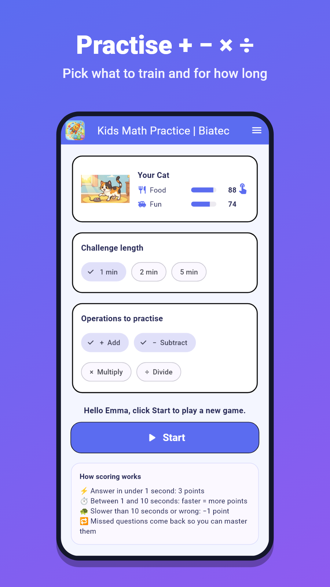
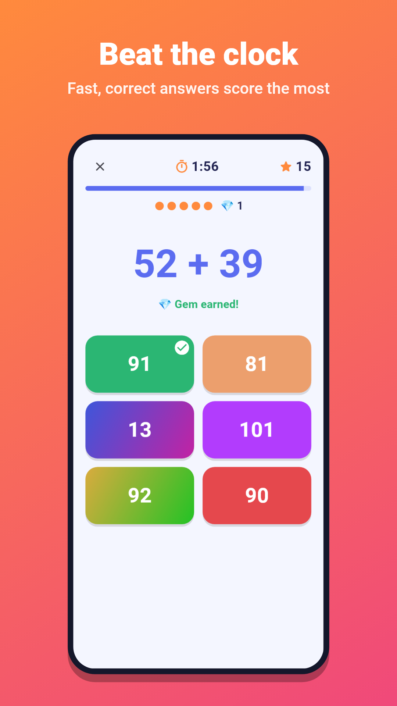
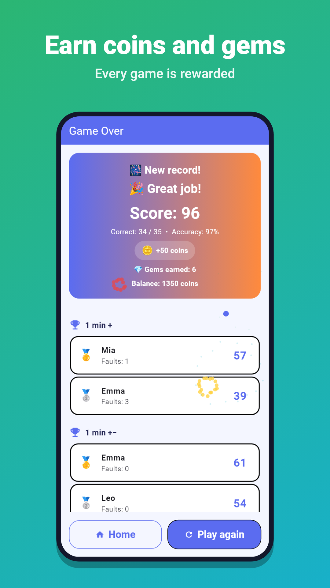
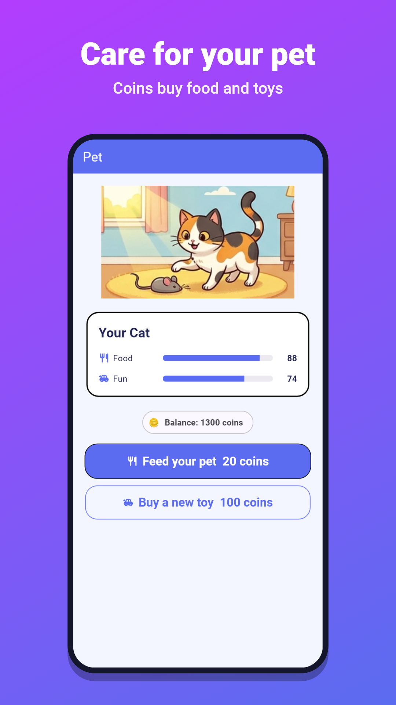
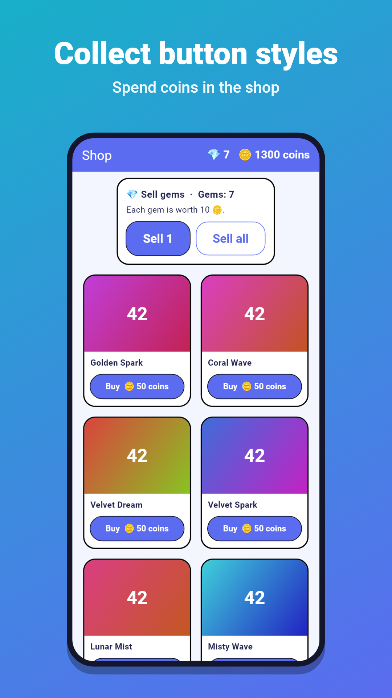
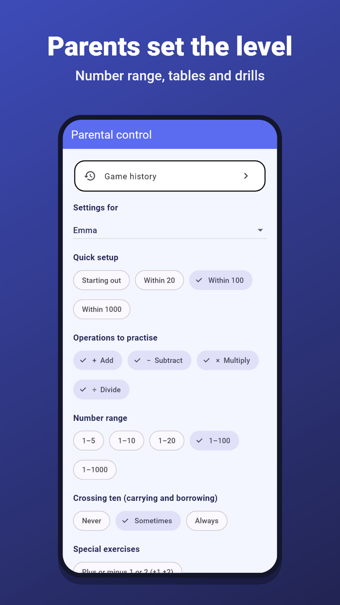
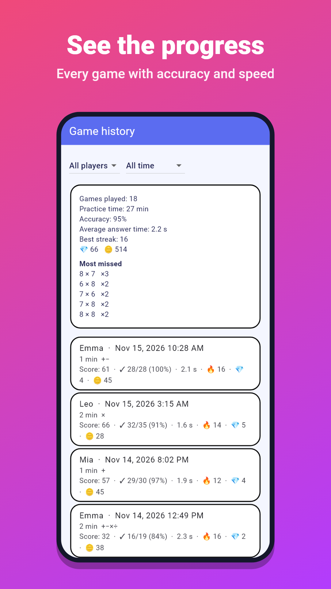
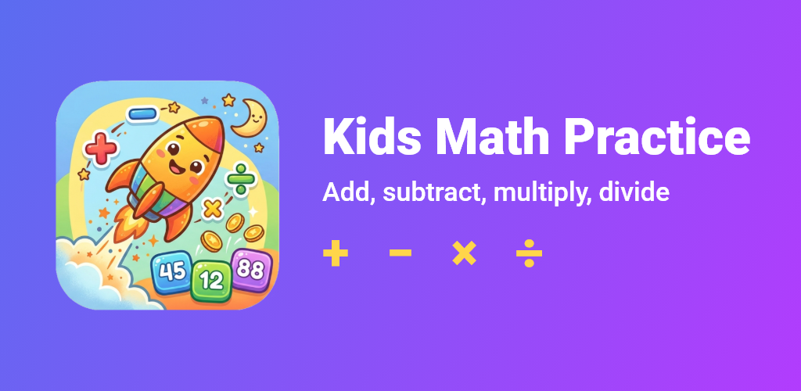

# Store screenshots and app icons

The pictures for Google Play and the App Store are **generated from the real
app**, so they can be re-created whenever the game changes. No device or
emulator is needed.

<p>
  
  
  
  
</p>
<p>
  
  
  
</p>



## Generate the screenshots

```bash
flutter pub get
flutter test tool/screenshots/store_screenshots_test.dart
```

This writes every picture to `docs/screenshots/<language>/<store slot>/`. It
takes about a minute.

| Option | Meaning |
| --- | --- |
| `--dart-define=SCREENSHOT_LOCALE=sk` | Language of the app and the captions (default `en`). |
| `--dart-define=SCREENSHOT_DEVICES=play-phone,ios-iphone-6.9` | Only render these store slots (folder names from the table below). The feature graphic is always rendered. |
| `--plain-name 02-game` | Only render pictures whose name contains this text. |

Only the English phone set and the feature graphic are committed (they are the
pictures on this page). Everything else in `docs/screenshots/` is git-ignored.
The **CI workflow** generates the full set on every run: download the
`store-screenshots` artifact from a run to get all sizes without a local
Flutter installation.

## Sizes

Each folder is one upload slot in a store console.

| Folder or file | Size (px) | Upload to |
| --- | --- | --- |
| `play-phone` | 1080 × 1920 | Google Play → Phone screenshots |
| `play-tablet-7` | 1080 × 1920 | Google Play → 7-inch tablet screenshots |
| `play-tablet-10` | 1440 × 2560 | Google Play → 10-inch tablet screenshots |
| `play-feature-graphic.png` | 1024 × 500 | Google Play → Feature graphic |
| `ios-iphone-6.9` | 1320 × 2868 | App Store → iPhone 6.9" display |
| `ios-iphone-6.5` | 1284 × 2778 | App Store → iPhone 6.5" display |
| `ios-ipad-13` | 2064 × 2752 | App Store → iPad 13" display |

All pictures are portrait PNG files **without an alpha channel**, which both
stores require.

Where the numbers come from (checked in November 2026):

- **Google Play** ([Add preview assets](https://support.google.com/googleplay/android-developer/answer/9866151)):
  JPEG or 24-bit PNG without alpha; each side 320–3840 px and the long side at
  most twice the short side; 2–8 screenshots per device type. To be eligible
  for promotion, Google recommends at least four screenshots of 1080 px or more
  in 9:16 (portrait) or 16:9. Tablet screenshots: 9:16 or 16:9, each side
  1080–7680 px. Feature graphic: exactly 1024 × 500. App icon: 512 × 512 PNG
  (`assets/icons/math_master_icon.png`).
- **App Store** ([Screenshot specifications](https://developer.apple.com/help/app-store-connect/reference/app-information/screenshot-specifications)):
  PNG or JPEG without transparency, up to 10 per size. iPhone 6.9": 1320 × 2868
  (1290 × 2796 and 1260 × 2736 are also accepted). iPhone 6.5": 1284 × 2778 or
  1242 × 2688. iPad 13": 2064 × 2752 or 2048 × 2732. Smaller devices use scaled
  versions of these.

The stores change these rules from time to time. If an upload is rejected,
check the two pages above and change the sizes in the `_devices` list.

## How it works

`tool/screenshots/store_screenshots_test.dart` is a Flutter widget test that
writes files instead of checking behaviour (it is not in `test/`, so a normal
`flutter test` does not run it). For every picture it:

1. fills the app with demo data (players, pets, coins, bought styles, played
   games) through the same services the app uses;
2. shows a real screen at the size of a phone or tablet and brings it into the
   wanted state (for example, it answers a few questions in a game);
3. draws that screen into a device frame under a caption and saves the PNG.

Things to know:

- **Fonts.** A widget test has no system fonts. The generator loads Roboto and
  the Material icons from the Flutter SDK, and emoji and symbols from
  `tool/screenshots/fonts/` (small subsets of Noto Color Emoji and Noto Sans
  Symbols 2). When the app starts to show a new emoji, rebuild the subsets:
  `pip install fonttools`, then `python tool/screenshots/subset_fonts.py`.
- **Languages.** Roboto covers Latin and Cyrillic scripts, so `ja`, `ko` and
  `zh` screenshots need a font for those scripts first. Captions exist in
  English and Slovak (`_captions`); other languages use the English captions
  until theirs are added.
- **Not pixel-identical.** The question in the game picture and the fireworks
  in the results picture are random, and the history shows dates relative to
  today, so these pictures differ slightly between runs.

### Add or change a picture

Add a `_Scene` to the `_scenes` list (id, backdrop colours and a function that
pumps the screen), and a caption for its id in `_captions`. The number in the
file name is the position in the list, which is also a good order for the
store listing.

## App icons

Every launcher icon comes from `assets/icons/math_master_icon.png`. The
platform folders are created by `flutter create` with the Flutter logo, and
`flutter_launcher_icons` replaces it:

| Platform | Configuration | Command |
| --- | --- | --- |
| Android, iOS | `flutter_launcher_icons:` in `pubspec.yaml` | `dart run flutter_launcher_icons` |
| Web | `tool/icons/web.yaml` | `dart run flutter_launcher_icons -f tool/icons/web.yaml` |
| Windows | `tool/icons/windows.yaml` | `dart run flutter_launcher_icons -f tool/icons/windows.yaml` |

Android gets an adaptive icon (the picture on a light-blue background), so the
launcher shows it without a white plate around it. The picture fills a squircle
mask; a round mask trims only its corners.

CI proves that no Flutter logo is left before it builds:
`python tool/check_launcher_icons.py snapshot <platforms>` remembers the
template icons right after `flutter create`, and `verify <platforms>` fails the
build if any of them is unchanged after the icons were generated. Locally, take
the snapshot on freshly created platform folders only.

> Never put a file named `flutter_launcher_icons-<name>.yaml` in the project
> root. The tool treats it as a "flavor" and then ignores the Android/iOS
> configuration in `pubspec.yaml`. That is how a release once shipped with the
> Flutter logo.
